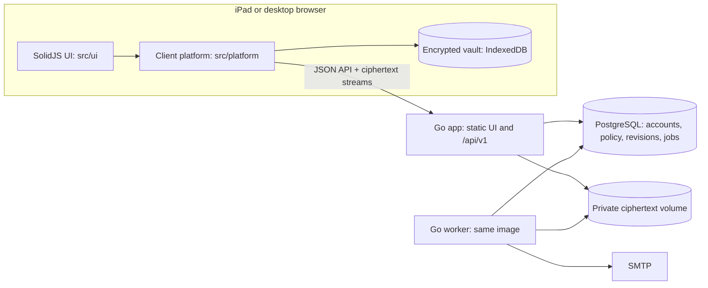

# Architecture overview

One page for orientation. The [architecture proposal](plan/architecture.md) and the [access and encryption contract](plan/access-and-encryption.md) hold the full contracts; [decision records](adr/README.md) say why things are the way they are; [milestone records](milestones/README.md) say what was built and verified.

## Shape

The client does all content work: decoding images, drawing, measuring, estimating, reports and exports, and encrypting everything before it leaves the device. The server authorizes, stores ciphertext, commits revisions and runs jobs; it never reads project content ([ADR 0002](adr/0002-client-side-encryption.md)). Backend and stack choice: [ADR 0001](adr/0001-go-postgresql-backend.md).

## Where code lives

| Path                        | Owns                                                                                                                                                                                                                                                              |
| --------------------------- | ----------------------------------------------------------------------------------------------------------------------------------------------------------------------------------------------------------------------------------------------------------------- |
| `src/ui/`                   | Components, tokens and semantic CSS by feature: account access, projects, the surface editor (`editor/`), controls, control registry; `router/` (route table, guards, deep links) and `app-context/` (`useApp()`, [ADR 0006](adr/0006-router-and-app-context.md)) |
| `src/stories/`              | Storybook compositions on synthetic in-memory data, including the editor's review host                                                                                                                                                                            |
| `src/platform/`             | Client logic without DOM ownership: `api` (generated client), `vault` (keys, encrypted local store, files, backups, revision queue), `projects` (hierarchy, drawing, planar geometry, sharing, sync), `images` (decode workers), `estimates`, `reports` (exports) |
| `src/app/`                  | App entry, offline shell and service worker                                                                                                                                                                                                                       |
| `server/cmd/calirestore`    | One Go binary: serve, worker, migrate, bootstrap                                                                                                                                                                                                                  |
| `server/internal/`          | Identity, sessions, policy, administration, projects, files, sharing, deletion and jobs                                                                                                                                                                           |
| `server/migrations/`        | Ordered PostgreSQL migrations                                                                                                                                                                                                                                     |
| `contracts/openapi.json`    | API contract; `npm run api:generate` regenerates `src/platform/api`                                                                                                                                                                                               |
| `deploy/`                   | Compose files, pinned versions and [operations runbook](../deploy/README.md)                                                                                                                                                                                      |
| `tests/`, `tests-platform/` | Storybook browser tests; app and platform browser suites                                                                                                                                                                                                          |

File size, colocation and naming follow the [source layout conventions](source-layout.md).

## Key flows

- **Identity.** Server sessions are revocable cookies; policy is one backend service with named capabilities. Mail goes through a PostgreSQL outbox claimed by the worker.
- **Vault.** Each account has a local encrypted vault unlocked on trusted devices or with a recovery key. Content keys never leave authorized clients.
- **Files and revisions.** Originals are immutable, chunked and encrypted locally first, then uploaded against a storage reservation and published only if `base_revision` still matches; a stale base is a conflict the client resolves.
- **Sharing.** Invitations bind to a verified account; grants are scoped (assessment, estimate, history) and wrapped per recipient. Revocation is enforced in PostgreSQL on every request, and keys are rotated for the remaining recipients ([M-06](milestones/m06-sharing.md)).
- **Editor.** One shell, `EditorWorkspace`, renders the shipped editor and its Storybook stories ([ADR 0004](adr/0004-one-editor-workspace.md)).

## Targets and delivery

- iPad landscape and portrait, and desktop; not phones ([ADR 0003](adr/0003-ipad-and-desktop-only.md)).
- One CI workflow with parallel frontend, Go and end-to-end jobs. Every commit is signed; pull requests merge by fast-forwarding `main` ([ADR 0005](adr/0005-fast-forward-merges.md)).
- Delivery order is the [platform plan](plan/README.md); current state and next step are in the [handoff](handoff/README.md).
