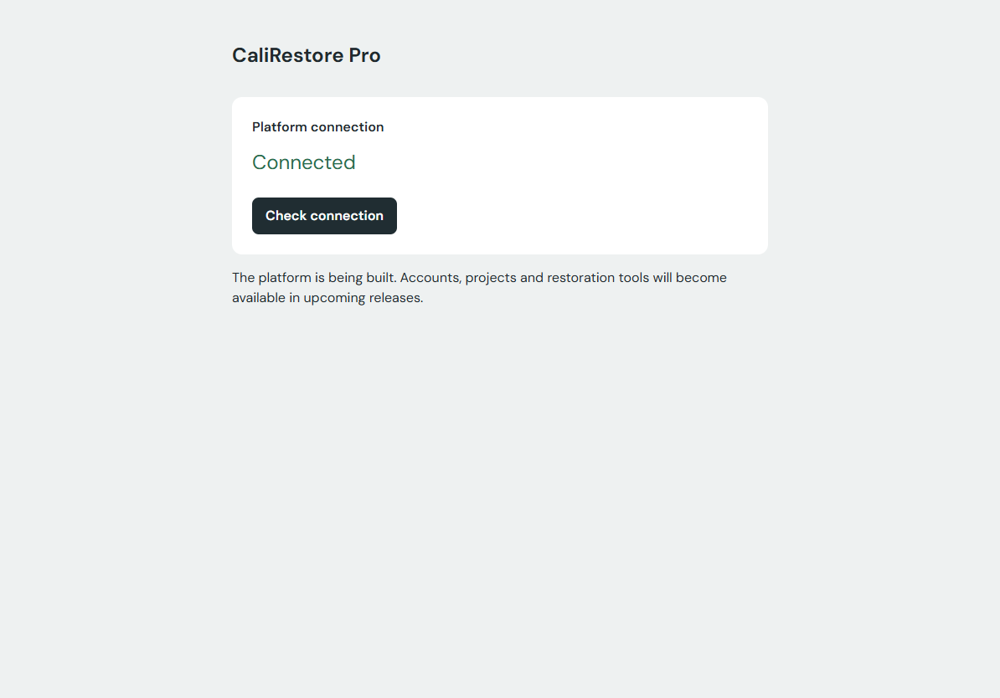
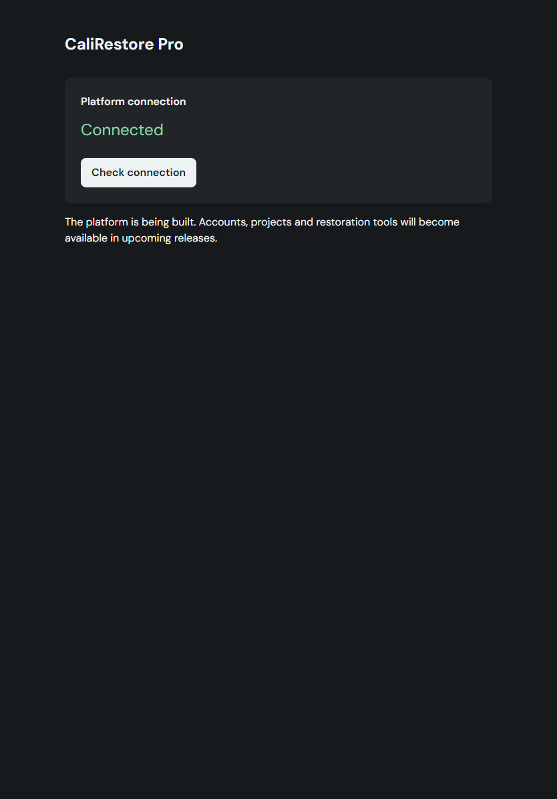

# M-00 verification · 4 November 2026

M-00 implements the Docker/API/database substrate. The next functional slice is M-01 identity. No project, account, mail-delivery, content-encryption, sync, measurement or drawing acceptance is claimed.

## Scope and prerequisite

This milestone is based on `feat/storybook-foundations`, which contains both merged prerequisite PRs [UI #1](https://github.com/sicza95/cali-restore-pro/pull/1) and [M-PLAN #2](https://github.com/sicza95/cali-restore-pro/pull/2). At implementation time `main` contained the UI squash only; the planning PR had merged into the UI branch. The M-00 PR targets that branch so the review diff contains only M-00. Retarget after the planning branch reaches `main`; no automatic merge is requested.

## Reproducible local checks

Linux amd64 containers on Windows Docker Desktop 4.97.0, Engine 29.9.2 and Compose 5.6.1; pinned Node 24.22.2, Go 1.27.3 and PostgreSQL 18.6. The app is loopback port 8080. This machine overrides the mail viewer to 18025 because another application uses 8025.

| Check                        | Evidence                                                                                                                                                                                                |
| ---------------------------- | ------------------------------------------------------------------------------------------------------------------------------------------------------------------------------------------------------- |
| Frontend static checks       | `npm run check`: TypeScript, ESLint and Prettier pass                                                                                                                                                   |
| Product build                | `npm run build` and the Docker Node build stage pass; no Storybook photograph or Node runtime ships                                                                                                     |
| Storybook                    | `npm run build-storybook` passes; original 24-story library remains independent                                                                                                                         |
| UI browser regression        | `npm test`: all 11 checks pass, including all-story smoke, keyboard/dialog behavior, responsive layouts and axe                                                                                         |
| Product browser integration  | `npm run test:app`: both checks pass; real Go-served shell/API, no console/page errors, two themes, two iPad orientations, axe, explicit unavailable/retry state                                        |
| Go and PostgreSQL            | Test image passes gofmt, vet and `go test -race -count=1 ./...`; integration test actually runs against the disposable `test-db` service                                                                |
| Migration invariants         | Three simultaneous migrators serialize; repeat runs leave one row; unmigrated/modified history fails readiness; modified history cannot be reapplied                                                    |
| Database permissions         | App role cannot create a table or modify migration history; only migration-history reads granted                                                                                                        |
| Clean Compose substrate boot | Fresh named database/objects volumes initialize roles, run one-shot migrations and reach healthy app, worker and mail sink                                                                              |
| Dependency loss and restart  | `npm run test:platform` verifies liveness stays 200, readiness/status become 503, worker readiness fails, database recovery restores readiness, and app/worker restart successfully                     |
| Dependency scans             | `npm audit`: zero findings; pinned govulncheck 1.9.0: no vulnerabilities found after updating x/text to 0.41.0                                                                                          |
| Backup and isolated restore  | Quiesced custom dump + objects tar + hashed manifest restored into fresh `calirestore-restore-m00c` volumes; schema history compared, migration command passed and `M00-synthetic-object` bytes matched |
| Restore isolation            | Destination app/migrator are only Created; database is healthy with no published port; worker/tunnel remain absent; live volumes are untouched                                                          |

The runtime smoke also rejects a production HTTP origin and a missing secret before serving. `backup-smoke.mjs` passes an additional synthetic object round trip, refuses existing destination volumes and rejects a tampered manifest hash.

The CI workflows repeat clean npm installation, retained UI verification, generated-contract drift checking, product build, dependency scans, real PostgreSQL integration, fresh Compose startup, app browser checks, outage/restart and backup/isolated restore. Their actual PR results are reported with the PR, rather than inferred from local success.

Failures discovered during verification were fixed: conflicting Go ServeMux patterns, a generator peer-version mismatch, YAML parser and x/text advisories, YAML flow-list tmpfs parsing, internal-network-only host port suppression, an occupied mail viewer port, missing favicon and empty restore-volume ownership. These fixes were verified at the relevant boundary. No upstream peer checks were bypassed.

## UI inspection

The product screen uses the existing DM Sans and semantic tokens, with no alternative visual system or synthetic business data. It answers “can this browser reach the platform?” through the real status query and a keyboard-accessible retry button. The built server was inspected at 1440, 768 and 390px: zero failures, one `hero-void` warning. The empty space is intentional for this single-status bootstrap screen; adding mock account/project panels would misrepresent M-00. No draw/redraw was needed for this bounded addition to the established UI system.

Landscape/portrait Storybook screenshots and product screenshots were opened for visual review. The product title/status/action remain readable and aligned; the narrow layout keeps the same reading order without horizontal overflow. Storybook retains its left tool rail, photograph and portrait inspector below the canvas. Browser images are evidence of layout, not physical Safari/Pencil qualification.

Product screenshots are generated under `test-results/platform/`; Storybook screenshots remain under the existing `test-results/ui-*` paths. Inspector screenshots/report live in ignored `.taste-skill/inspect/`. Two product screenshots are copied below for review; remaining runtime/test artifacts and generated development secrets are not committed. Failure traces are generated in the browser output directory.

## PRIV-06 partial boundary

The only persisted application table is `schema_migrations`: migration filename/version, SQL SHA-256 and application timestamp. PostgreSQL also holds its normal catalog/role data. There are no plaintext project names, file names, object/surface rows, image/EXIF data, measurements, notes, rates or real user records.

Application JSON logs allow timestamp, level, fixed lifecycle/error category and dependency readiness boolean. They omit requests/headers, IP addresses, database URLs/passwords, bearer tokens, content keys and payloads. The public operational endpoints expose only fixed health/status and milestone values; dependency errors remain generic. HTTP API responses are no-store; hashed static assets contain only the bootstrap client. No access logger, analytics or optional crash-reporting client is installed. Database/ingress logging remains an operational responsibility and must join the full minimized allowlist before production identity/content use.

This is partial PRIV-06 evidence only. M-03 must specify and test the complete operational metadata/log allowlist alongside encryption formats; M-16 acceptance still applies. The worker is a dependency monitor, the mail sink is unused infrastructure, and backup support covers only this substrate. Revocation-safe recovery, committed ciphertext watermarks, missing/corrupt chunk verification and retention enforcement remain M-04/M-07 gates. No language-performance claim or full container supply-chain audit is implied by these code dependency scans.
