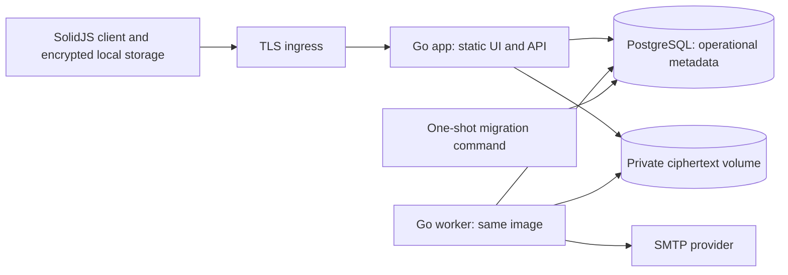

# Recommended application and Docker architecture

Status: implementation proposal, 4 November 2026. See the [milestones](README.md) for delivery order and the [access contract](access-and-encryption.md) for security semantics.

## Backend choice

Keep SolidJS, TypeScript, Vite, semantic CSS and Storybook. Recommend **Go** for the new backend: a compiled service with explicit concurrency/cancellation boundaries and streaming I/O fits ciphertext transfer, access policy and background work. Start with `net/http`, PostgreSQL through `pgx`, explicit SQL migrations and an OpenAPI contract generating the TypeScript client. Add libraries only for concrete needs; pin supported versions and validate licenses/security at M-00.

This is a maintainability/deployment choice with performance potential, not a benchmark claim. Rust remains a candidate for later client/WASM geometry or decoding where measured work justifies it; it need not own account CRUD. ASP.NET Core is a credible backend alternative with a larger integrated identity ecosystem, but introduces a different framework/tooling commitment. Retaining Node would reduce language switching; Go is recommended because the owner has explicitly opened the backend decision and the new repository has no backend to migrate. No backend language accelerates Pencil rendering performed in the browser.

Use PostgreSQL for transactional account, membership, quota, grant and job state. Its concurrency controls fit atomic last-owner checks, storage reservations and conditional revisions. Store large ciphertext bytes outside database rows. Start with a mounted filesystem object adapter; preserve an interface for later S3-compatible storage rather than adding an object server immediately. Keep object storage private behind the authenticated API.

## Deployment shape



| Service       | Responsibility                                                                                                           | Exposure/persistence                                                                                         |
| ------------- | ------------------------------------------------------------------------------------------------------------------------ | ------------------------------------------------------------------------------------------------------------ |
| `app`         | Serve Vite build and `/api/v1`; sessions, authorization, encrypted transfer, revision commit and administrative commands | Same browser origin; private container network in production; ciphertext volume mounted separately from code |
| `worker`      | Claim durable mail/outbox and maintenance jobs; retries, staging cleanup, deletion/backup expiry                         | Same immutable Go image with a different command; no public listener; least-privilege DB/filesystem access   |
| `migrate`     | Apply ordered SQL migrations once before compatible app/worker startup                                                   | One-shot job; schema-writing credentials kept separate from application DB rights                            |
| `db`          | Account/policy/session/grant/revision/quota/outbox/audit state                                                           | Persistent PostgreSQL volume; no public production port                                                      |
| `mail-sink`   | Inspect verification/reset/invitation mail in development                                                                | Development profile; local binding only; never a production mail relay                                       |
| `cloudflared` | Optional outbound tunnel to the healthy app                                                                              | Production tunnel profile; secret-mounted token; pinned image                                                |

The old app's `docker-compose.yml`, Dockerfile and server modules are reference inputs: preserve persistent data, secure cookies, health checks, same-origin serving and optional tunnel ingress. Replace the Express runtime, SQLite/global user flags and full-JSON project transfer rather than copying legacy source or formats. Use fresh new-format projects; no legacy conversion is required.

Use a Node build stage for the existing frontend and a Go build stage for the backend. The runtime contains the compiled service and static assets; Node is not a production server dependency. Run Linux containers as a non-root user, with a read-only code filesystem and explicit writable data/tmp locations. Define liveness separately from readiness and include a binary health-check command so the image needs no shell/curl. Wait for healthy PostgreSQL and successful migrations; also handle runtime dependency loss and graceful shutdown rather than relying solely on startup order.

Development binds the app and mail viewer to loopback, with a documented trusted-HTTPS route for LAN iPad testing. Production uses trusted HTTPS through the tunnel or an independently operated reverse proxy. Trust forwarded headers only from configured ingress. Cache hashed static assets; authentication/API responses are private/no-store. A cached shell is not authenticated access. Never put private API responses or decrypted assets in the service worker cache.

## Source ownership

Keep the existing frontend layout initially; add boundaries without a speculative monorepo migration:

```text
src/ui/                    existing shared components and tokens
src/stories/               synthetic review compositions
src/app/                   router, account/project/admin screens, composition
src/domain/                versioned project, units, estimation, command contracts
src/platform/              API client, vault, local store, assets and sync
src/editor/                UI adapters now; actual engine in final phase
server/cmd/calirestore/    serve / worker / migrate / bootstrap subcommands
server/internal/          identity, policy, projects, objects, jobs, mail, audit
server/migrations/        ordered PostgreSQL schema changes
contracts/                OpenAPI and versioned encrypted-format specifications
deploy/                   Compose configuration and operational runbooks
tests/                    browser workflows and integration fixtures
```

These are proposed locations, not existing implementations. Domain code has no DOM, network, key-secret or canvas dependency. UI uses commands/query results; it does not own duplicated project truth. The renderer never knows account roles. Server packages never parse decrypted project content. Keep the current Storybook commands separate from the new product app entry point.

## Two data models

**Client domain:** project → objects → surfaces → source/reference/mapping photos, assessments, masks, category folders, work phases and checkpoints. Units inherit project → object → surface; child overrides are explicit. Personal rate/productivity/pattern/branding libraries are separate encrypted documents. Estimates and reports retain revision provenance. Original images and named checkpoints are immutable references, not per-checkpoint byte copies. Panel/tool/view state stays outside the canonical document except explicit encrypted recovery drafts/preferences.

**Server operational model:** users and verified addresses; password verifiers and revocable sessions; account roles/feature grants/quotas; public encryption identities/encrypted envelopes; opaque projects/access domains/memberships/invitations; host responsibility; ciphertext resources, revisions, key epochs, uploads and byte reservations; generic outbox/jobs, minimized audit and deletion tombstones. Authorization-scoped labels are permitted where required for enforcement. Object/surface hierarchy, names, filenames, geometry, dimensions/EXIF, rates, measurements, notes, thumbnails and report contents remain encrypted. Do not add plaintext `objects`, `surfaces` or searchable project-name columns for convenience.

Registration grants local/offline work. An invitation grants remote access to its specific project; an admin broader-feature grant enables hosting personal projects/personal-library sync. Neither membership nor billing is inferred from registration. A project's bytes count once against its designated eligible owner, whoever uploaded them.

## Transfer, commit and worker contracts

Use small JSON operational messages and binary ciphertext streams. Enforce request size, chunk count, time and concurrent transfer bounds without inventing fixed project/object/layer count limits. File type/original metadata validation happens on the client; the server can validate only permitted envelope shape, ciphertext size, protocol and authorization. Never claim server antivirus can inspect encrypted images.

1. Persist encrypted local chunks and a manifest transactionally before acknowledging local durability.
2. Authorize upload initiation and reserve storage growth against the hosting account in PostgreSQL. Support idempotent resumable staging, cancellation and bounded expiry.
3. Stream immutable encrypted chunks into staging, verifying byte counts and ciphertext integrity checks. Ciphertext checksums do not reveal plaintext hashes and do not replace AEAD verification.
4. Publish only when all references exist, policy/membership/key epochs are current, quota is committed and `base_revision` still matches. A stale base returns conflict; retries use operation IDs.
5. Commit the manifest pointer and accounting together. On crash, unreferenced bytes remain reclaimable staging; a committed revision must not point at absent data. Client decrypt verifies context/authentication before interpretation.

Use PostgreSQL-backed leased jobs and a transactional outbox initially. Claim jobs atomically, retry with backoff, cap attempts and expose dead jobs for authorized review. External SMTP delivery is at least once; use stable message identities where supported and never promise exactly-once email. Replay must not extend/reuse consumed reset or invitation tokens. Mail jobs containing necessary bearer links need server-side protected storage separate from project encryption, redacted logs and short retention; store only token digests in validation tables. Document infrastructure-key rotation and old queued-job handling. Keep content keys out of all jobs.

No Redis, Kafka, Kubernetes or mandatory S3 service is needed for the initial deployment. Revisit only when measured concurrency, resilience or deployment requirements justify it. Start backend load fixtures with concurrent login, project listings, chunk streams and worker backlog; record warm/cold behavior and resource limits rather than promising arbitrary requests per second.

## Operations and recovery

Provide `.env.example` with non-secret configuration names and production startup failure for missing/unsafe settings. Mount service secrets through Docker secrets/`*_FILE` inputs; no production default password, session secret or tunnel token. Bootstrap creates the first superuser explicitly and idempotently, without logging credentials or reseeding it at normal startup.

Back up PostgreSQL and immutable ciphertext at a coherent committed watermark. Include protocol/migration versions and needed **infrastructure** secret recovery; never collect client content keys. Restore into an isolated environment, check manifests against bytes, and reapply the current access/revocation/deletion ledger before exposing it. Keep an independently durable current ledger so restoring an old database cannot resurrect removed access or purged content. Verify the 30-day live recovery and 90-day total deleted-backup expiry with the actual backup provider/layout. Backups that cannot enforce this policy are not production-ready.

Use expand/contract migrations, a migration lock and an explicit client/API/schema compatibility window. Rollback may require a compatible image or a tested restore; destructive migrations need a specific runbook. Service-worker updates preserve unsynced encrypted work and apply supported document upgrades on the client. Health/metrics/logs report permitted operational fields only; optional client diagnostics are off until opt-in.

## Primary technical references

These references support mechanisms, not an app benchmark or completed implementation. Consulted 4 November 2026.

- [Go database connection management](https://go.dev/doc/database/manage-connections): connection pool bounds; use equivalent explicit limits with the chosen PostgreSQL driver.
- [PostgreSQL SELECT locking](https://www.postgresql.org/docs/current/sql-select.html): queue-oriented `SKIP LOCKED`; lease/claim correctness still needs integration tests.
- [Compose startup order](https://docs.docker.com/compose/how-tos/startup-order/): health-gated dependencies and successful one-shot services.
- [Compose secrets](https://docs.docker.com/compose/how-tos/use-secrets/): file-mounted service secrets; host secret-file protection remains operational work.
