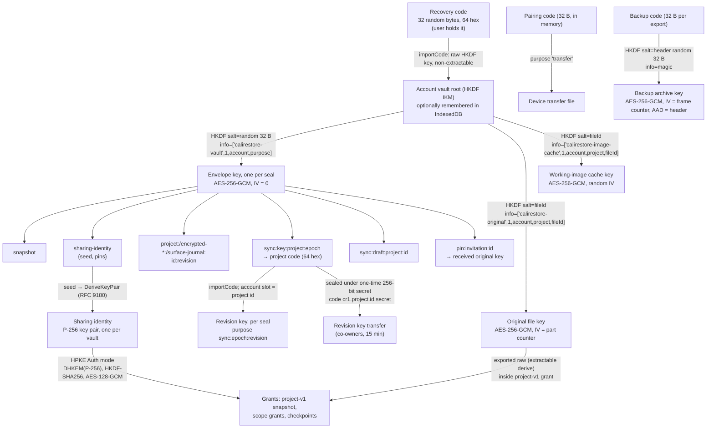

# Internal cryptographic review (preparation pack)

Date: 2026-11-17 · Issue: #52 · Status: internal preparation, not a sign-off

An agent wrote this review on the owner's instruction of 2026-11-17. It prepares the independent
external review required before collaborative production use
([M-03](../milestones/m03-client-vault.md), [access and encryption](../plan/access-and-encryption.md)).
It does not replace that review. Findings of medium severity or higher become their own issues. This
document changes no code.

Every statement below was checked against the source at the commit this file lands on. Line numbers
refer to that commit.

## Scope

| Area                          | Files                                                                                                                                                                                      |
| ----------------------------- | ------------------------------------------------------------------------------------------------------------------------------------------------------------------------------------------ |
| Client vault                  | `src/platform/vault/crypto.ts`, `vault.ts`, `store.ts`, `file-format.ts`, `files.ts`, `image-cache.ts`, `backup-format.ts`, `project-backups.ts`, `original-pins.ts`, `offline-account.ts` |
| Project sync keys             | `src/platform/projects/revisions.ts`, `revision-key-transfer.ts`, `src/platform/vault/revision-queue.ts`                                                                                   |
| Sharing (HPKE grants)         | `src/platform/projects/fixture-sharing.ts`, `shared-originals.ts`, `sharing-scopes.ts`, `src/ui/sharing/*`                                                                                 |
| Revocation and rotation       | `server/internal/projects/original_rotation.go`, `invitations.go`, `owners.go`, `edit_scopes.go`, `revision_keys.go`                                                                       |
| Server password hashing       | `server/internal/identity/passhash/passhash.go`, `store.go`                                                                                                                                |
| Operational archives          | `server/internal/oparchive/oparchive.go`, `scripts/operational-backup.mjs`, `server/migrations/0020_deletion_retention.sql`                                                                |
| Object store                  | `server/internal/objectstore/objectstore.go`, `server/internal/projects/files.go`, `files_http.go`                                                                                         |
| Adjacent (read, not in brief) | `server/internal/identity/lifecycle.go` (mail outbox AEAD), `sessiontoken/sessiontoken.go`, `server/internal/platform/http.go` (CSP)                                                       |

Out of scope: TLS and ingress configuration, the build and delivery chain for client code, the
`@hpke/core` implementation itself, browser and OS key storage.

## Key hierarchy

Server-side keys are independent of the client hierarchy:

- Account passwords: Argon2id verifiers. They never derive content keys.
- Operational archive key: 32 random bytes per archive, stored in PostgreSQL
  (`operational_archive_keys.key_hex`), AES-256-GCM over a tar of the `encrypted-v1` object store.
- Mail outbox key: 32-byte operator secret from `MAIL_KEY_FILE`, AES-256-GCM.
- Session tokens: 32 random bytes; SHA-256 digest stored; CSRF value is `SHA-256("csrf:" + token)`.

## Primitive inventory

| Use                                                           | Primitive and parameters                                                                                                                               | Nonce                                                 | AAD / context binding                                                                                                | Code                                                      |
| ------------------------------------------------------------- | ------------------------------------------------------------------------------------------------------------------------------------------------------ | ----------------------------------------------------- | -------------------------------------------------------------------------------------------------------------------- | --------------------------------------------------------- |
| Recovery, pairing, backup, project and transfer codes, stamps | `crypto.getRandomValues`, 32 bytes, lowercase hex                                                                                                      | n/a                                                   | n/a                                                                                                                  | `crypto.ts:21-24`                                         |
| Root import                                                   | Web Crypto raw `HKDF` key, non-extractable; input bytes zeroed after import                                                                            | n/a                                                   | n/a                                                                                                                  | `crypto.ts:26-35`                                         |
| Vault envelope v1                                             | HKDF-SHA-256 (salt 32 random bytes, info = context) → AES-256-GCM, 128-bit tag                                                                         | Fixed all-zero 96-bit IV; key is single-use per salt  | `["calirestore-vault",1,account,purpose]` as both HKDF info and GCM AAD                                              | `crypto.ts:67-85`, `106-121`                              |
| Envelope parsing                                              | JSON `{version:1,salt,ciphertext}`, canonical padded Base64 re-encoded and compared, salt exactly 32 bytes, size bound per purpose                     |                                                       | Authenticated before UTF-8/JSON decode                                                                               | `crypto.ts:41-65`, `123-134`                              |
| Original file chunks                                          | HKDF-SHA-256 (salt = UTF-8 file UUID, info = context) → AES-256-GCM; 1 MiB chunks, part 0 = manifest                                                   | Deterministic: IV = 64 zero bits ‖ uint32 part number | `["calirestore-original",1,account,project,id,part]`; manifest carries authenticated `size`                          | `file-format.ts:38-77`, `80-95`                           |
| Working-image cache                                           | HKDF-SHA-256 (salt = file UUID) → AES-256-GCM                                                                                                          | Random 96-bit IV prefixed to each record              | `["calirestore-image-cache",1,account,project,id,part]`                                                              | `image-cache.ts:32-77`                                    |
| Project backup v2 (`CRPROJ02`)                                | Fresh 32-byte code per export; HKDF-SHA-256 (salt = 32 random header bytes, info = magic) → AES-256-GCM                                                | IV = 64 zero bits ‖ uint32 frame counter              | Entire 44-byte header (magic, salt, index length) as AAD; total size checked against the authenticated index         | `backup-format.ts:1-56`, `project-backups.ts:124-191`     |
| Project revision (sync)                                       | Vault envelope under project code root                                                                                                                 | As envelope                                           | `["calirestore-vault",1,projectId,"sync:"+epoch+":"+revision]`                                                       | `revisions.ts:12-38`                                      |
| Project key at rest                                           | Vault envelope, purpose `sync:key:project:epoch`                                                                                                       | As envelope                                           | As envelope                                                                                                          | `revision-queue.ts:171-191`                               |
| Revision key transfer                                         | Vault envelope under a fresh 256-bit secret; secret travels out of band in `cr1.project.id.secret`                                                     | As envelope                                           | `["calirestore-vault",1,recipient,"sync:transfer:project:id:epoch:syncEpoch"]`                                       | `revision-key-transfer.ts:9-80`                           |
| Sharing identity                                              | `@hpke/core` 1.10.0 `DeriveKeyPair` on a 32-byte random seed, P-256                                                                                    | n/a                                                   | Fingerprint = SHA-256 of the serialized public key, compared in full (64 hex) by the user                            | `fixture-sharing.ts:54-72`                                |
| Grants                                                        | HPKE (RFC 9180) Auth mode, DHKEM(P-256, HKDF-SHA256), HKDF-SHA256, AES-128-GCM, single-shot, empty `info`                                              | HPKE key schedule                                     | AAD: `["calirestore",<kind>,1,1,project,invitation,sender,recipient]`, scope and checkpoint variants add scope or id | `fixture-sharing.ts:17-231`                               |
| Versioned original id                                         | `SHA-256("calirestore-original-epoch-v1:"+project+":"+epoch+":"+source)` truncated to 128 bits, UUID-formatted                                         | n/a                                                   | Implemented twice (TS, Go)                                                                                           | `shared-originals.ts:60-74`, `original_rotation.go:19-22` |
| Password verifier                                             | Argon2id v19, m = 19456 KiB, t = 2, p = 1, 16-byte salt, 32-byte output; fixed prefix only; constant-time compare; dummy verifier for unknown accounts | n/a                                                   | n/a                                                                                                                  | `passhash.go:15-50`, `store.go:45-47`, `119-145`          |
| Operational archive                                           | Node `aes-256-gcm`, random 32-byte key and 96-bit IV per archive, single stream                                                                        | Random                                                | AAD = archive UUID                                                                                                   | `operational-backup.mjs:56-131`                           |
| Mail outbox                                                   | Go AES-256-GCM, static operator key                                                                                                                    | Random 96-bit                                         | Constant `calirestore-mail-v1`                                                                                       | `lifecycle.go:22-33`, `52-64`                             |
| Object store integrity                                        | SHA-256 of each ciphertext part, client-sent header checked, stored digest re-checked on read                                                          | n/a                                                   | Integrity only; confidentiality and authenticity come from the client AEAD                                           | `files_http.go:178-199`, `objectstore.go:58-69`           |

## Threat model

"Protected" means the design and code achieve the property under the stated attacker; "Partial" means
it holds with conditions; "Not protected" is either a documented non-goal or a gap.

| Attacker                                                                     | Confidentiality of content                                                                                                                                                                                  | Integrity / authenticity                                                                                                                              | Freshness and revocation                                                                                                                                                                          | Notes                                        |
| ---------------------------------------------------------------------------- | ----------------------------------------------------------------------------------------------------------------------------------------------------------------------------------------------------------- | ----------------------------------------------------------------------------------------------------------------------------------------------------- | ------------------------------------------------------------------------------------------------------------------------------------------------------------------------------------------------- | -------------------------------------------- |
| Malicious or compromised server (database, objects, API), honest client code | Protected: envelopes, chunks and grants are client-encrypted; server holds no unwrapping secret. Metadata visible: ids, sizes (including manifest length, so filename length), epochs, memberships, timing. | Protected against swap/splice: AAD binds account, project, file id, part, purpose and revision. Key substitution blocked by manual fingerprint check. | Not protected: server can replay older heads and grants (F-1) and decides when epochs rotate (F-2).                                                                                               | Serving malicious JS is out of scope (M-03). |
| Member (read-only invitee)                                                   | Partial: receives only sealed snapshot, chosen scopes and per-file original keys; never the root, project code or other files' keys.                                                                        | Cannot forge grants (HPKE Auth mode bound to owner's key).                                                                                            | Scope narrowing is server enforcement only; delivered content stays with the member (expected).                                                                                                   |                                              |
| Revoked member or removed co-owner                                           | Retains everything already delivered, including original keys and (co-owner) the old project code. Server denies new fetches.                                                                               | n/a                                                                                                                                                   | Partial: server rotates `sync_epoch` and `original_epoch` and re-encrypts originals under new ids; enforcement depends on the server (F-2). Offline pins delete only on an explicit denial (F-8). |                                              |
| Stolen device, locked browser, session-only vault                            | Protected: IndexedDB holds ciphertext only; the root needs the recovery code.                                                                                                                               | Partial: consistent rollback of local rows is not detected (F-6).                                                                                     | n/a                                                                                                                                                                                               |                                              |
| Stolen device with "remember this browser"                                   | Not protected (documented): non-extractable root handle in IndexedDB unlocks everything for anyone with the browser profile.                                                                                | Same                                                                                                                                                  | n/a                                                                                                                                                                                               | Opt-in, warned in M-03.                      |
| Backup leak (project backup file)                                            | Protected without the per-export backup code. Header reveals index length; file size reveals total size.                                                                                                    | Protected: header AAD, frame counter, size check against authenticated index.                                                                         | Older valid backups restore as a new project id (by design).                                                                                                                                      |                                              |
| Backup leak (vault recovery file)                                            | Protected without the recovery code. Contains only the `snapshot` envelope.                                                                                                                                 | Protected                                                                                                                                             | n/a                                                                                                                                                                                               | Does not carry the sharing identity (F-3).   |
| Operational archive leak                                                     | Archive alone: protected. Archive plus a database copy: object ciphertext (still client-encrypted) and file layout are exposed (F-7).                                                                       | GCM over the whole stream; restore verifies before extraction.                                                                                        | Crypto-shredding after 60 days depends on database backup retention (F-7).                                                                                                                        |                                              |
| Same-origin script injection (XSS)                                           | Not protected (documented non-goal). While unlocked, script can open every envelope and read long-term secrets as strings (F-5). CSP `script-src 'self'` lowers the likelihood.                             | Not protected                                                                                                                                         | Sharing identity compromise is permanent because it cannot rotate (F-3).                                                                                                                          |                                              |

## Findings

Severity: critical (exploitable break of a stated guarantee), high (likely loss of confidentiality or
integrity in a realistic setting), medium (a stated design goal is not met, or a gap needs an
explicit decision), low (hardening, limited impact), info (observation or documentation).

| ID   | Severity | Title                                                                                       |
| ---- | -------- | ------------------------------------------------------------------------------------------- |
| F-1  | Medium   | HPKE grants carry no epoch or freshness binding; a server can replay stale grants and heads |
| F-2  | Medium   | Revocation depends on server-chosen epochs that clients cannot verify                       |
| F-3  | Medium   | Sharing identity cannot be backed up, transferred, recovered or rotated                     |
| F-4  | Low      | Deterministic file keys with counter nonces rely on an unenforced "seal once per id" rule   |
| F-5  | Low      | Long-term secrets exist as extractable strings despite the non-extractable root             |
| F-6  | Low      | Local IndexedDB rows can be rolled back consistently                                        |
| F-7  | Low      | Operational archive keys live in the database they protect against                          |
| F-8  | Low      | Offline pins fail open on anything other than an explicit denial                            |
| F-9  | Low      | Argon2id at the OWASP minimum with no rehash path                                           |
| F-10 | Info     | Envelope design: per-message key with a fixed zero IV                                       |
| F-11 | Info     | Context field `account` is overloaded with project and recipient ids                        |
| F-12 | Info     | HPKE uses AES-128-GCM, empty `info`, Auth mode (KCI)                                        |
| F-13 | Info     | Legacy backup v1 and sharing `fixture-v1` remain accepted                                   |
| F-14 | Info     | Metadata visible to the server                                                              |
| F-15 | Info     | Mail outbox AAD is constant                                                                 |
| F-16 | Info     | Versioned original id is implemented twice without a shared vector                          |

Counts: critical 0, high 0, medium 3, low 6, info 7.

No nonce reuse, weak randomness, missing chunk authentication, plaintext-before-authentication or
algorithm downgrade was found. All random values come from `crypto.getRandomValues`,
`crypto.randomUUID`, Node `randomBytes` or Go `crypto/rand`; there is no `Math.random` in key or
identifier paths.

### F-1 · Medium · HPKE grants carry no epoch or freshness binding

- `src/platform/projects/fixture-sharing.ts:37-52`: the snapshot AAD is
  `["calirestore", kind, 1, 1, project, invitation, sender, recipient]`. Both numeric fields are
  constants. [M-06](../milestones/m06-sharing.md) states the AAD binds "scope, format and epoch"; no
  epoch is present.
- `fixture-sharing.ts:119-134` (scope grants) and `180-192` (checkpoints) likewise bind no epoch,
  revision or grant version.
- `server/internal/projects/original_rotation.go:130-157`: `rotateOriginals` overwrites the grant
  ciphertext in place under the same AAD. The pre-rotation envelope therefore stays a valid
  ciphertext for the same context.
- `src/platform/projects/revisions.ts:34-38`: revision heads bind `epoch:revision`, so only whole older
  heads can be replayed, but a device without local state cannot detect a rollback.

Impact: a malicious server can serve an older project snapshot, an older estimate scope, or the
pre-rotation original list to a member indefinitely, and the client accepts it as current. The
access plan asks to "define freshness/rollback limits rather than claiming AEAD alone proves the
latest revision"; no limit or watermark is implemented for grants.

### F-2 · Medium · Revocation depends on server-chosen epochs

- `src/platform/projects/revisions.ts:20`, `src/platform/projects/editor-sync.ts:16`,
  `src/platform/vault/revision-queue.ts:171-191`: the project key epoch is whatever `sync_epoch` the
  server reports; a new project code is provisioned only when that value changes.
- `src/platform/projects/shared-originals.ts:60-75`: the re-encrypted original id (and therefore its
  key, `file-format.ts:38-59`) is a deterministic function of the server-reported `original_epoch`.
  With an empty epoch the source id and the source key are shared directly (`:61`).
- `server/internal/projects/original_rotation.go:24-46` and `owners.go:64-77` perform the rotation.

Impact: an honest server rotates correctly. A malicious server colluding with a revoked member or a
removed co-owner can keep reporting the old epoch, so remaining owners keep sealing new revisions
under the project code the removed co-owner holds, and "rotated" originals reuse keys the revoked
member already has. Clients have no signed record of membership or epoch changes. This is a
design-level gap against the "malicious server" column, not an implementation bug; it needs an
explicit decision (accept and document, or client-authenticated epoch transitions).

### F-3 · Medium · Sharing identity cannot be backed up, transferred, recovered or rotated

- `src/platform/vault/vault.ts:182-205`: the P-256 seed and peer pins live only in
  `row.sharingIdentity`.
- `vault.ts:223-225`: `backup()` exports only the `snapshot` envelope.
- `vault.ts:64-71`: `#install` (used by `restore`, `:97-104`) writes a row without `sharingIdentity`;
  `acceptTransfer` (`:110-118`) goes through `#create` and also starts without it. A fresh seed is then
  generated on first use (`:190`).
- `vault.ts:192-193`: peers that pinned the old fingerprint get a hard `Sharing identity changed` error
  with no review path.

Impact: losing the browser profile, restoring from the recovery file, or adding a device yields a new
identity; existing grants sealed to the old key become unreadable, and pinned peers are blocked.
There is also no way to rotate a compromised identity. M-06 documents "Sharing keys require the
browser vault in which they were created", but [M-03](../milestones/m03-client-vault.md) and the access
plan require stable identity replacement that "pauses new grants and requires owner review".

### F-4 · Low · Deterministic file keys with counter nonces rely on an unenforced rule

`src/platform/vault/file-format.ts:38-77` derives the key from `(root, account, project, id)` and uses
the part number as the IV. This is safe only if the same id is never sealed with different
plaintext. Today every writer respects that: `files.ts:103` uses a fresh UUID,
`project-backups.ts:206-214` uses a fresh project and file id, and `files.ts:204-223` reseals the
identical decrypted bytes under a versioned id (identical ciphertext on retry, which the server
accepts, `files.go:206-224`). Nothing in `fileCipher` or `fileCipherWithKey` enforces the rule, and
no test asserts it. A future "replace file" or "edit manifest" feature could reuse a nonce silently.

### F-5 · Low · Long-term secrets exist as extractable strings

The root handle is non-extractable (`crypto.ts:31`), but while the vault is unlocked any same-origin
script can call `open` and obtain the sharing seed as a hex string (`vault.ts:185-190`), project
codes (`revision-queue.ts:188`), and raw original keys (`files.ts:197-201`, derived with
`extractable: true`). Same-origin script is an accepted non-goal in M-03, and the CSP
(`server/internal/platform/http.go:73`) is strict. The external reviewer should still note that, with
F-3, one XSS yields a permanent sharing identity compromise.

### F-6 · Low · Local IndexedDB rows can be rolled back consistently

Local documents bind `id:revision` in the purpose (`project-store.ts:41-44`), so a row is
authenticated only against its own revision number. An attacker with write access to the browser
profile can restore an older `(revision, envelope)` pair and it opens cleanly. The vault `stamp`
(`store.ts:93-95`) is an unauthenticated compare-and-swap token, not a watermark. M-03 already
excludes rollback detection offline; this records that the local store has the same property.

### F-7 · Low · Operational archive keys live in the database

`scripts/operational-backup.mjs:123-131` stores the archive key as hex in `operational_archive_keys`,
in the same PostgreSQL instance whose copy is needed for restore; migration
`0020_deletion_retention.sql:46-51` gives the app role `SELECT (id, expires_at)` only, which is good,
but the migrator role and any database backup or WAL archive hold the key. `oparchive.go:18-21`
deletes expired keys, so the 90-day deletion guarantee holds only if database backups also expire
within that window. The archive content is already client-encrypted object ciphertext, which limits
impact to layout and size metadata. Restore authenticates the whole stream into a null sink first
(`operational-backup.mjs:186-196`) and decrypts a second time into `tar` (`:244`); the file is not
re-checked between the two passes.

### F-8 · Low · Offline pins fail open

`src/platform/vault/original-pins.ts:141-165` re-checks access only when online and treats only
401/403/404/410 as revocation (`shared-originals.ts:34`). Timeouts and 5xx still open the pin. This is
the intended offline behaviour; record it as a revocation limit in the user-facing copy and the
review pack.

### F-9 · Low · Argon2id at the OWASP minimum with no rehash path

`server/internal/identity/passhash/passhash.go:15` and `:29`: m = 19 MiB, t = 2, p = 1 is the OWASP
minimum profile. `Verify` (`:35-37`) accepts only this exact prefix, so raising the parameters later
needs a migration that rehashes on next login; otherwise existing verifiers stop verifying. Timing is
otherwise sound: constant-time compare (`:49`), dummy verifier for unknown accounts
(`store.go:45-47`, `:133-139`), and the length check short-circuits only on the submitted password.

### F-10 · Info · Per-message key with a fixed zero IV

`crypto.ts:73-83`, `:109`: each seal derives a fresh AES-256-GCM key from a 32-byte random salt and
uses a zero IV. This is sound (key-nonce pair unique with overwhelming probability) and documented in
M-03; it depends entirely on the CSPRNG. The context is used as both HKDF info and GCM AAD.

### F-11 · Info · Context field `account` is overloaded

`["calirestore-vault",1,account,purpose]` carries the project id for revisions
(`revisions.ts:24-29`, `:37`) and the recipient id for key transfers
(`revision-key-transfer.ts:47-52`). Different roots (project code, one-time secret) separate these
domains, and purposes use distinct prefixes, so no collision was found. A label per field would make
the format self-describing.

### F-12 · Info · HPKE choices

`fixture-sharing.ts:17-21`: AES-128-GCM where the rest of the system uses AES-256-GCM (acceptable;
consistent with the P-256 security level). All binding is in AAD with empty HPKE `info`, which is
equivalent for single-shot use. Auth mode authenticates the sender but is not resistant to
key-compromise impersonation: whoever holds a recipient's private key can forge grants to that
recipient from any sender.

### F-13 · Info · Legacy formats still accepted

`backup-format.ts:27`: `CRPROJ01` backups import. The magic is the HKDF info (`:39`), so a v2 archive
cannot be relabelled as v1. `fixture-sharing.ts:101-116`: `fixture-v1` only accepts a fixed synthetic
string. Neither is a downgrade path; both should get a removal date.

### F-14 · Info · Metadata visible to the server

Exact source size and manifest length (`files.ts:104-105`), chunk count, file ids, epochs, revision
numbers, ciphertext length per revision, scope names, membership and timing. Manifest length reveals
the filename length to within the JSON overhead. This matches the ADR 0002 allowlist except that
filename length is not named there.

### F-15 · Info · Mail outbox AAD is constant

`server/internal/identity/lifecycle.go:61-62` uses the fixed AAD `calirestore-mail-v1`. A database
writer could move a sealed payload between rows, but the payload already carries its own recipient
and token together, so this has no practical effect. Binding the row id and purpose is cheap.

### F-16 · Info · Versioned original id implemented twice

`shared-originals.ts:60-74` and `original_rotation.go:19-22` must agree byte for byte. No shared test
vector checks this. The output is a truncated SHA-256 formatted as a UUID without version bits; it is
used as an identifier and HKDF salt, not as a secret.

### Positive observations

- AAD binds account, purpose, project, file id, part and revision everywhere; swapped or spliced
  ciphertext fails (`crypto.ts:73`, `file-format.ts:71`, `image-cache.ts:50`).
- Authentication before parsing, with strict canonical Base64 and bounded sizes
  (`crypto.ts:41-65`, `files.ts:296-303`, `file-transfer.ts:46-64`).
- Truncation and extension of files and backups are caught through authenticated sizes
  (`file-format.ts:84-95`, `project-backups.ts:190-191`).
- Recipient keys are verified by a full 64-hex fingerprint typed on every open or grant
  (`src/ui/sharing/InvitationInbox.tsx:107-108`, `ProjectInvitations.tsx:241-242`).
- Backup restore re-encrypts every original under a new project and file id
  (`project-backups.ts:205-214`).
- Server compares secrets in constant time (CSRF: `server/internal/identity/http.go:93`; passwords:
  `passhash.go:49`).

## Test vectors

Existing:

- `tests-platform/fixtures/vault-v1.json`: vault envelope v1, produced independently with Node
  `hkdfSync` and `createCipheriv` (M-03). `src/platform/vault/crypto.test.ts:79` also cross-checks
  both directions.
- `server/internal/identity/passhash/passhash_test.go`: round trip and malformed verifiers, no
  known-answer vector.

Missing (each should be produced by an independent implementation, as the vault vector was):

1. Original file format: key derivation, part 0 manifest and two data parts, including the
   last-chunk length rule.
2. Working-image cache record (random IV prefix, part numbering −1, −2…).
3. Project backup v2 and v1: header, index frame, document frames, one original; plus truncated and
   extended negatives.
4. Revision head `sync:epoch:revision` and revision key transfer envelope.
5. HPKE: `DeriveKeyPair` from a fixed seed, fingerprint, and one sealed `project-v1`, scope and
   checkpoint grant with fixed `enc` (cross-checked against another RFC 9180 implementation).
6. Versioned original id, shared by the TS and Go tests (F-16).
7. Argon2id known-answer vector for the fixed parameters.
8. Operational archive stream and mail outbox record.

## Questions for the external reviewer

1. Is the zero-IV, per-message-HKDF-key envelope (F-10) acceptable as the long-term format, or should
   v2 move to a random nonce under a per-purpose key?
2. Is deterministic per-file keying with a counter IV (F-4) acceptable given the invariant, and what
   enforcement do you require?
3. What freshness guarantee should grants and revision heads provide against the server (F-1):
   signed monotonic counters, client-held watermarks, or a documented limit?
4. Is server-driven epoch rotation (F-2) acceptable for the stated threat model, or must membership
   and epoch changes be authenticated by an owner's key?
5. How should a sharing identity be recovered, transferred and rotated (F-3), and how should peers
   review a changed fingerprint?
6. Is HPKE Auth mode appropriate given its KCI property (F-12), or should grants use Base mode plus an
   explicit sender signature?
7. Is AES-128-GCM in HPKE acceptable alongside AES-256-GCM elsewhere?
8. Are the Argon2id parameters appropriate for the deployment budget, and what rehash policy do you
   recommend (F-9)?
9. Should operational archive keys be held outside PostgreSQL, and how should their deletion relate
   to database backup retention (F-7)?
10. Is the metadata leakage in F-14 (notably filename length and exact sizes) acceptable, or should
    manifests and parts be padded?
11. Does the `@hpke/core` 1.10.0 dependency meet your bar for a vetted implementation?
